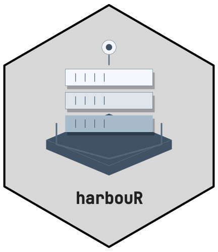
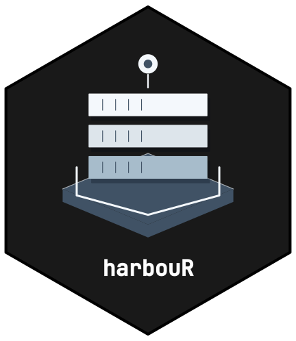

<!-- cttir-vignette-logo: start -->
<style>
.cttir-vignette-logo { float: right; width: 120px; max-width: 30%; margin: 0 0 1rem 1.5rem; }
.cttir-vignette-logo img { width: 100%; height: auto; border: 0; background: transparent; box-shadow: none; }
.cttir-vignette-logo .cttir-vignette-logo-light { display: block; }
.cttir-vignette-logo .cttir-vignette-logo-dark { display: none; }
@media (prefers-color-scheme: dark) {
  .cttir-vignette-logo .cttir-vignette-logo-light { display: none; }
  .cttir-vignette-logo .cttir-vignette-logo-dark { display: block; }
}
[data-bs-theme="light"] .cttir-vignette-logo .cttir-vignette-logo-light { display: block; }
[data-bs-theme="light"] .cttir-vignette-logo .cttir-vignette-logo-dark { display: none; }
[data-bs-theme="dark"] .cttir-vignette-logo .cttir-vignette-logo-light { display: none; }
[data-bs-theme="dark"] .cttir-vignette-logo .cttir-vignette-logo-dark { display: block; }
</style>
<div class="cttir-vignette-logo">
  
  
</div>
<!-- cttir-vignette-logo: end -->


```{r setup, include = FALSE}
knitr::opts_chunk$set(collapse = TRUE, comment = "#>")
```


`hb_run_explorer()` launches a Shiny app for working with a SeaTable
base without writing any R. Reach for it when you want to *see* what is
in a base; reach for the programmatic API (`hb_read_table()`,
`hb_query()` and friends) when you want to *do* something with the data.

The app and its UI dependencies (`shiny`, `bslib`, `reactable`) live in
`Suggests`, so the client itself stays headless. If something is missing,
the launcher names it. The Excel download also needs `writexl`; without
it, the app tells you so when you ask for a workbook.

## Open something

You can try the app right now with no SeaTable account and no network:

```{r demo, eval = FALSE}
harbouR::hb_run_explorer()
```

Then choose **Use the example base** in the Source panel. It loads a
bundled `.dtable` holding a column of nearly every type harbouR supports,
so every panel has something to show.

The Source panel takes three kinds of input:

* **A `.dtable` file.** Drop in a SeaTable export and work entirely
  offline. Nothing leaves your machine.
* **A server.** A URL and an API token. The token field is never
  pre-filled from your environment, because a value passed to a password
  input is written into the page's HTML.
* **The example base**, above.

Shiny refuses uploads larger than 5 MB unless told otherwise, and an
export with attachments is often bigger than that, so while the explorer
runs it accepts files up to 1 GB. To choose another limit, set the
`shiny.maxRequestSize` option, in bytes, before you start the app; a
value you set yourself is left as it is:

```{r upload-limit, eval = FALSE}
options(shiny.maxRequestSize = 2 * 1024^3) # 2 GB
harbouR::hb_run_explorer()
```

You can also hand the app something you already have. Extract a file's
assets when you open it, as the Source panel does, or a `.dtable`
download leaves its attachments behind:

```{r preset, eval = FALSE}
harbouR::hb_run_explorer(
  harbouR::hb_read_dtable("my-base.dtable", assets = "extract")
)
harbouR::hb_run_explorer(harbouR::hb_client())
```

## The panels

The left rail lists every table in the base. Under each name is a band of
coloured segments - one per column, coloured by what kind of thing the
column holds. It is there so you can see the *shape* of a sixty-column
table before you open it: a table that is mostly measurements looks
different from one that is mostly text.

* **Data.** The table as a tibble, searchable and filterable. List-valued
  cells - attachments, multi-selects - are joined for display, because a
  cell shows one value. Set how many rows to read.
* **Schema.** Every column, the SeaTable type it holds, the R type
  harbouR reads it as, its four-character key, and whether it can be
  written. The colours match the bands in the rail.
* **Query.** A SeaTable SQL console. It needs a server: a `.dtable` is a
  file, not a database, and the panel says so rather than failing.
* **Export.** Download the base as `.dtable`, as an Excel workbook, or as
  zipped CSVs - or just the table you are looking at, as one CSV holding
  all of its rows, however many the Data panel shows, each cell written
  as the panel shows it. A `.dtable` of a base opened from a file keeps
  everything. A live base has no file behind it, so its `.dtable` is
  rebuilt from the rows: it keeps the values, but not the column types,
  select options, attachments or views, and the app says so when you
  download it. The workbook and the zipped CSVs flatten whatever a cell
  cannot hold, which the app tells you about.

## Colour

The explorer retains its viridis palette independently of the package badge.
The palette is colourblind-safe and perceptually uniform. Column types are grouped into families - text,
quantity, time, choice, attachment, relationship, and the ones SeaTable
maintains itself - and each family keeps its colour everywhere in the
app, so the rail and the schema table read as one system.

## Next steps

* `vignette("harbouR")` - the five-minute end-to-end story.
* `vignette("column-types")` - the coercion layer in detail.
